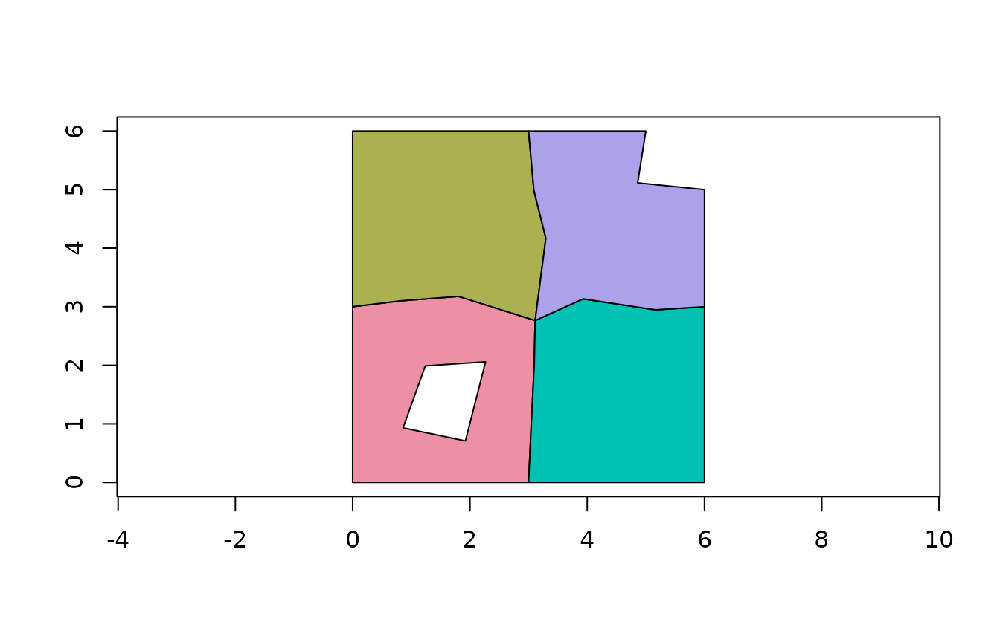
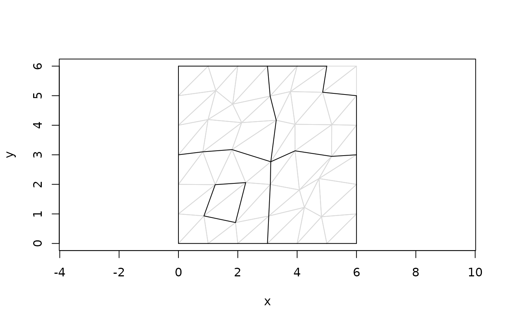
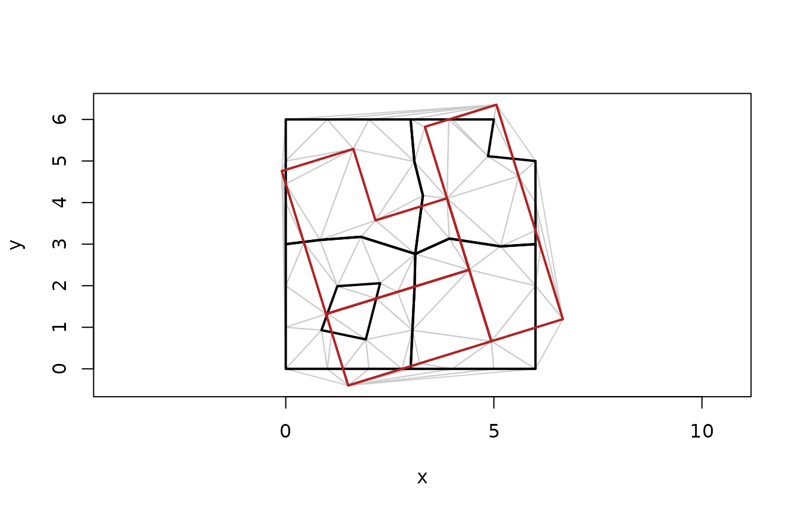

# Questions on a mesh

Many of the questions asked of polygons, the `ST_*` functions of SQL
databases and GEOS, can be answered from a triangulation of them without
forming the polygons at all. Area and centroid are sums over triangles.
Two regions touch when they share a vertex or an edge but no triangle,
and that is a question about integer ids, not coordinates. A point is in
a region when it is in one of its triangles.

The `tri_*()` functions answer these questions on a `wkpool_tri`, a
triangle pool whose triangles share vertex ids. For two separate layers
(two meshes, or a mesh and some lines or points),
[`tri_overlay()`](https://hypertidy.github.io/wkpool/reference/tri_overlay.md)
first puts them into one mesh, and then the relation between any two
features is read in the same way. They are new in wkpool 0.5.0, and like
the triangle pool itself are **experimental**.

``` r

library(wkpool)
```

## A small coverage

A grid of unit squares, two triangles each, with the inner vertices
moved so that nothing lines up. Any constrained triangulation of a
coverage gives a mesh like this (see the Triangulation vignette); here
it is built by hand so that nothing else is needed.

``` r

n <- 6L
g <- expand.grid(i = 0:n, j = 0:n)
v <- data.frame(.vx = seq_len(nrow(g)), x = as.double(g$i), y = as.double(g$j))
set.seed(1)
inner <- v$x > 0 & v$x < n & v$y > 0 & v$y < n
v$x[inner] <- v$x[inner] + runif(sum(inner), -0.3, 0.3)
v$y[inner] <- v$y[inner] + runif(sum(inner), -0.3, 0.3)
id <- function(i, j) j * (n + 1L) + i + 1L
cell <- expand.grid(i = seq_len(n) - 1L, j = seq_len(n) - 1L)
a <- id(cell$i, cell$j)
b <- id(cell$i + 1L, cell$j)
c <- id(cell$i + 1L, cell$j + 1L)
d <- id(cell$i, cell$j + 1L)
tri <- new_wkpool_tri(v, vx0 = c(a, a), vx1 = c(b, c), vx2 = c(c, d))
tri
#> <wkpool_tri[72 triangles, 49 vertices]>
#>  [1] <triangle: 1,2,9>    <triangle: 2,3,10>   <triangle: 3,4,11>  
#>  [4] <triangle: 4,5,12>   <triangle: 5,6,13>   <triangle: 6,7,14>  
#>  [7] <triangle: 8,9,16>   <triangle: 9,10,17>  <triangle: 10,11,18>
#> [10] <triangle: 11,12,19> <triangle: 12,13,20> <triangle: 13,14,21>
#> [13] <triangle: 15,16,23> <triangle: 16,17,24> <triangle: 17,18,25>
#> [16] <triangle: 18,19,26> <triangle: 19,20,27> <triangle: 20,21,28>
#> [19] <triangle: 22,23,30> <triangle: 23,24,31> <triangle: 24,25,32>
#> [22] <triangle: 25,26,33> <triangle: 26,27,34> <triangle: 27,28,35>
#> [25] <triangle: 29,30,37> <triangle: 30,31,38> <triangle: 31,32,39>
#> [28] <triangle: 32,33,40> <triangle: 33,34,41> <triangle: 34,35,42>
#> [31] <triangle: 36,37,44> <triangle: 37,38,45> <triangle: 38,39,46>
#> [34] <triangle: 39,40,47> <triangle: 40,41,48> <triangle: 41,42,49>
#> [37] <triangle: 1,9,8>    <triangle: 2,10,9>   <triangle: 3,11,10> 
#> [40] <triangle: 4,12,11>  <triangle: 5,13,12>  <triangle: 6,14,13> 
#> [43] <triangle: 8,16,15>  <triangle: 9,17,16>  <triangle: 10,18,17>
#> [46] <triangle: 11,19,18> <triangle: 12,20,19> <triangle: 13,21,20>
#> [49] <triangle: 15,23,22> <triangle: 16,24,23> <triangle: 17,25,24>
#> [52] <triangle: 18,26,25> <triangle: 19,27,26> <triangle: 20,28,27>
#> [55] <triangle: 22,30,29> <triangle: 23,31,30> <triangle: 24,32,31>
#> [58] <triangle: 25,33,32> <triangle: 26,34,33> <triangle: 27,35,34>
#> [61] <triangle: 29,37,36> <triangle: 30,38,37> <triangle: 31,39,38>
#> [64] <triangle: 32,40,39> <triangle: 33,41,40> <triangle: 34,42,41>
#> [67] <triangle: 36,44,43> <triangle: 37,45,44> <triangle: 38,46,45>
#> [70] <triangle: 39,47,46> <triangle: 40,48,47> <triangle: 41,49,48>
```

Groups of triangles stand for polygons. Here four regions are made of
cells, with a hole in region 1 and a few cells left out.

``` r

region <- ifelse(cell$i < 3, ifelse(cell$j < 3, 1L, 2L), ifelse(cell$j < 3, 3L, 4L))
region[cell$i == 1 & cell$j == 1] <- NA   # a hole in region 1
region[cell$i == 5 & cell$j == 5] <- NA   # a notch out of region 4
group <- c(region, region)                # one value per triangle
```

``` r

plot(tri_dissolve(tri, group), col = hcl.colors(4, "Set 2"), asp = 1)
```



[`tri_dissolve()`](https://hypertidy.github.io/wkpool/reference/tri_dissolve.md)
is `ST_Union()` by group, walking the boundary edges of each group into
rings. The other functions need no rings at all.

## Measures

[`tri_measures()`](https://hypertidy.github.io/wkpool/reference/tri_measures.md)
gives area, perimeter, centroid, a point inside and the extent of each
group, as `ST_Area()`, `ST_Perimeter()`, `ST_Centroid()`,
`ST_PointOnSurface()` and `ST_Envelope()` would.

``` r

tri_measures(tri, group)
#>   group     area perimeter centroid_x centroid_y   point_x  point_y xmin
#> 1     1 8.053748  16.58768   1.505247   1.554608 0.6875395 2.363443    0
#> 2     2 9.323901  12.46095   1.596213   4.500517 2.7377638 3.370357    0
#> 3     3 8.784550  11.75047   4.535572   1.488166 5.1860270 1.700211    3
#> 4     4 7.538196  12.30035   4.452618   4.383853 4.6516069 4.388431    3
#>       ymin     xmax     ymax
#> 1 0.000000 3.112214 3.176544
#> 2 2.764766 3.295144 6.000000
#> 3 0.000000 6.000000 3.134227
#> 4 2.764766 6.000000 6.000000
```

## Relations

[`tri_relate()`](https://hypertidy.github.io/wkpool/reference/tri_relate.md)
gives the DE-9IM matrix, as `ST_Relate()` does, for every pair of groups
that share a vertex. Pairs it does not list are disjoint.

``` r

r <- tri_relate(tri, group)
r
#>   a b    relate
#> 1 1 2 FF2F11212
#> 2 1 3 FF2F11212
#> 3 1 4 FF2F01212
#> 4 2 3 FF2F01212
#> 5 2 4 FF2F11212
#> 6 3 4 FF2F11212
```

Each named predicate is a pattern on that string. Two groups touch when
their interiors do not meet (first character `F`) but they meet at all,
which in a coverage is every pair listed. Regions 1 and 4 (and 2 and 3)
meet only at the centre vertex, so the entry for boundary meeting
boundary (the fifth character) is `0`, a point, where the pairs that
share a line have `1`:

``` r

touches <- substr(r$relate, 1, 1) == "F"
r[touches & substr(r$relate, 5, 5) == "0", c("a", "b")]
#>   a b
#> 3 1 4
#> 4 2 3
```

Groups may overlap: give `group` as a table of triangle and group
instead. Here a fifth group covers the middle of the grid.

``` r

centre <- which(cell$i %in% 2:3 & cell$j %in% 2:3)
gt <- data.frame(
  triangle = c(seq_along(tri), centre, centre + nrow(cell)),
  group = c(group, rep(5L, 2 * length(centre)))
)
gt <- gt[!is.na(gt$group), ]
r5 <- tri_relate(tri, gt)
r5[r5$b == 5, ]
#>    a b    relate
#> 4  1 5 212101212
#> 7  2 5 212101212
#> 9  3 5 212101212
#> 10 4 5 212101212
```

The interiors of region 5 and each region meet in two dimensions (first
character `2`): they overlap.

## Points

[`tri_locate()`](https://hypertidy.github.io/wkpool/reference/tri_locate.md)
finds the triangle that holds each point, so the group of a point is one
lookup away. A point on an edge or vertex goes to the lowest triangle
that holds it, decided by exact arithmetic.

``` r

set.seed(2)
pts <- wk::xy(runif(10, -0.5, 6.5), runif(10, -0.5, 6.5))
i <- tri_locate(tri, pts)
data.frame(x = round(wk::wk_coords(pts)$x, 2), y = round(wk::wk_coords(pts)$y, 2),
           triangle = i, region = group[i])
#>       x    y triangle region
#> 1  0.79 3.37       19      2
#> 2  4.42 1.17       11      3
#> 3  3.51 4.82       64      4
#> 4  0.68 0.77       37      1
#> 5  6.11 2.34       NA     NA
#> 6  6.10 5.47       NA     NA
#> 7  0.40 6.33       NA     NA
#> 8  5.33 1.08       12      3
#> 9  2.78 2.61       51      1
#> 10 3.35 0.02        4      3
```

## Parts and holes

[`tri_structure()`](https://hypertidy.github.io/wkpool/reference/tri_structure.md)
counts the parts, holes and rings of each group, as `ST_NumGeometries()`
and `ST_NumInteriorRings()` would for the dissolved polygons. Region 1
has its hole, and region 4 is one part with a notch.

``` r

tri_structure(tri, group)
#>   group n_parts n_holes n_rings
#> 1     1       1       1       2
#> 2     2       1       0       1
#> 3     3       1       0       1
#> 4     4       1       0       1
```

## Boundaries, clipping and hulls

[`tri_boundary()`](https://hypertidy.github.io/wkpool/reference/tri_boundary.md)
gives each group’s boundary as segments on the same vertex pool,
directed with the group on the left. With `once = TRUE` an edge between
two groups is kept once, so each line is drawn once.

``` r

bnd <- tri_boundary(tri, group, once = TRUE)
plot(tri, col = NA, border = "grey85", asp = 1)
plot(bnd, col = "black", add = TRUE)
```



[`tri_clip_rect()`](https://hypertidy.github.io/wkpool/reference/tri_clip_rect.md)
clips the triangles by a rectangle and returns a mesh again, so all of
the above still applies to the result.
[`tri_convex_hull()`](https://hypertidy.github.io/wkpool/reference/tri_convex_hull.md)
gives the hull of each group as a polygon.

``` r

clipped <- tri_clip_rect(tri, c(1.5, 1.5, 4.5, 4.5))
clipped_group <- group[attr(clipped, "source")]
tri_measures(clipped, clipped_group)[, c("group", "area", "perimeter")]
#>   group     area perimeter
#> 1     1 2.041228  6.381437
#> 2     2 2.581524  6.493280
#> 3     3 2.112054  5.715015
#> 4     4 1.895960  5.971036
wk::as_wkt(tri_convex_hull(tri, group))[1]
#> <wk_wkt[1]>
#> [1] POLYGON ((0 0, 3 0, 3.096479 1.996125, 3.112214 2.764766, 1.805934 3.176544, 0.8235847 3.10108...
```

## Preparing a mesh for many questions

Each function above derives what it needs from the pool: the triangles
as rows of the vertex table, the edge table
([`tri_neighbours()`](https://hypertidy.github.io/wkpool/reference/tri_neighbours.md)),
the membership of triangles in groups and, for
[`tri_dissolve()`](https://hypertidy.github.io/wkpool/reference/tri_dissolve.md)
and
[`tri_structure()`](https://hypertidy.github.io/wkpool/reference/tri_structure.md),
the boundary rings.
[`tri_prepare()`](https://hypertidy.github.io/wkpool/reference/tri_prepare.md)
computes these once and keeps them with the pool, the mesh counterpart
of a prepared geometry in GEOS. Later calls with the same `group` read
the cache; another `group`, or a changed pool, is computed as usual, and
subsetting drops the cache.

``` r

ptri <- tri_prepare(tri, group)
tri_is_prepared(ptri)
#> [1] TRUE
identical(tri_structure(ptri, group), tri_structure(tri, group))
#> [1] TRUE
```

## Relations between layers

[`tri_relate()`](https://hypertidy.github.io/wkpool/reference/tri_relate.md)
compares groups of one mesh. To compare features of two layers that were
not triangulated together,
[`tri_overlay()`](https://hypertidy.github.io/wkpool/reference/tri_overlay.md)
puts both into one constrained triangulation (with the cdtr package), in
which every place they meet is a shared vertex or edge. A layer can be a
triangle mesh (polygons, as groups of triangles), lines, or points. Here
the second layer is a coarser grid, turned and moved so that its edges
cross the first.

``` r

m <- 3L
gb <- expand.grid(i = 0:m, j = 0:m)
th <- 0.3
vb <- data.frame(.vx = seq_len(nrow(gb)),
                 x = 1.8 * (gb$i * cos(th) - gb$j * sin(th)) + 1.5,
                 y = 1.8 * (gb$i * sin(th) + gb$j * cos(th)) - 0.4)
idb <- function(i, j) j * (m + 1L) + i + 1L
cb <- expand.grid(i = seq_len(m) - 1L, j = seq_len(m) - 1L)
tri_b <- new_wkpool_tri(
  vb,
  vx0 = c(idb(cb$i, cb$j), idb(cb$i, cb$j)),
  vx1 = c(idb(cb$i + 1L, cb$j), idb(cb$i + 1L, cb$j + 1L)),
  vx2 = c(idb(cb$i + 1L, cb$j + 1L), idb(cb$i, cb$j + 1L))
)
group_b <- rep(c(1L, 1L, 2L, 3L, 3L, 2L, 3L, NA, 2L), 2)
ov <- tri_overlay(tri, tri_b, group, group_b)
ov
#> <wkpool_overlay> 130 triangles, 70 vertices
#>   layer x: 4 polygon features
#>   layer y: 3 polygon features
```

``` r

plot(ov$mesh, col = NA, border = "grey80", asp = 1)
plot(tri_dissolve(tri, group), col = NA, border = "black", lwd = 2, add = TRUE)
plot(tri_dissolve(tri_b, group_b), col = NA, border = "firebrick", lwd = 2, add = TRUE)
```



[`tri_overlay_relate()`](https://hypertidy.github.io/wkpool/reference/tri_overlay_relate.md)
then gives the DE-9IM matrix for every pair of a feature of `x` and a
feature of `y` that are not disjoint.

``` r

tri_overlay_relate(ov)
#>   x y    relate
#> 1 1 1 212101212
#> 2 1 3 212101212
#> 3 2 3 212101212
#> 4 3 1 212101212
#> 5 3 2 212101212
#> 6 3 3 212101212
#> 7 4 2 212101212
#> 8 4 3 212101212
```

The same works for lines and points, against a mesh or against each
other. A line’s interior is its edges and the vertices inside it, and
its boundary is its two ends (where an odd number of its edges end, the
rule GEOS uses).

``` r

lines <- wk::wkt(c("LINESTRING (-1 1.5, 7 1.5)", "LINESTRING (1 1, 2 2, 1 2, 1 1)",
                   "LINESTRING (3 0, 3 6)"))
ovl <- tri_overlay(tri, lines, group)
head(tri_overlay_relate(ovl))
#>   x y    relate
#> 1 1 1 1F20F1102
#> 2 1 2 1F20F11F2
#> 3 1 3 1F2001102
#> 4 2 3 1F2001102
#> 5 3 1 1F20F1102
#> 6 3 3 FF2F01102
ovp <- tri_overlay(lines, wk::xy(c(1, 3, 5), c(1.5, 3, 1.5)))
tri_overlay_relate(ovp)
#>   x y    relate
#> 1 1 1 0F1FF0FF2
#> 2 1 3 0F1FF0FF2
#> 3 2 1 0F1FFFFF2
#> 4 3 2 0F1FF0FF2
```

The overlay is a mesh with groups, so measures of the pieces follow too:
the area of each feature of `x` inside each feature of `y` is the area
of the triangles they share.

``` r

mem <- ov$members
g <- ov$groups
in_x <- mem[g$layer[mem$group] == "x", ]
in_y <- mem[g$layer[mem$group] == "y", ]
both <- merge(in_x, in_y, by = "item")
pieces <- data.frame(triangle = both$item,
                     group = as.integer(factor(paste(both$group.x, both$group.y))))
area <- tri_measures(ov$mesh, pieces)$area
key <- levels(factor(paste(both$group.x, both$group.y)))
data.frame(x = g$id[as.integer(sub(" .*", "", key))],
           y = g$id[as.integer(sub(".* ", "", key))], area = round(area, 3))
#>   x y  area
#> 1 1 1 2.422
#> 2 1 3 2.922
#> 3 2 3 4.391
#> 4 3 1 3.061
#> 5 3 2 3.145
#> 6 3 3 0.995
#> 7 4 2 5.230
#> 8 4 3 0.868
```

## Triangles in Arrow

[`tri_as_arrow()`](https://hypertidy.github.io/wkpool/reference/tri_as_arrow.md)
writes a pool as an Arrow array (with nanoarrow) in which every triangle
is three indices into one shared vertex dictionary. By default each row
is a group, the list of its triangles, so an engine that evaluates
`ST_*` row by row sees one feature per row and the list offsets are the
feature-to-triangle ranges. This is the layout of the draft
`geoarrow.triangles` type, which is not part of GeoArrow.

``` r

arr <- tri_as_arrow(tri, group)
arr$length
#> [1] 4
back <- tri_from_arrow(arr)
all.equal(tri_measures(back$mesh, back$group), tri_measures(tri, group))
#> [1] TRUE
```

## Checking against GEOS

The tests check every function against geos. The same check here, for
area and the relation matrices:

``` r

polys <- geos::as_geos_geometry(tri_dissolve(tri, group))
all.equal(tri_measures(tri, group)$area, geos::geos_area(polys))
#> [1] TRUE
all(r$relate == geos::geos_relate(polys[r$a], polys[r$b]))
#> [1] TRUE
```

And between the layers of the overlay:

``` r

polys_b <- geos::as_geos_geometry(tri_dissolve(tri_b, group_b))
ro <- tri_overlay_relate(ov, expand.grid(x = 1:4, y = 1:3))
all(ro$relate == geos::geos_relate(polys[ro$x], polys_b[ro$y]))
#> [1] TRUE
rl <- tri_overlay_relate(ovl, expand.grid(x = 1:4, y = 1:3))
all(rl$relate == geos::geos_relate(polys[rl$x], geos::as_geos_geometry(lines)[rl$y]))
#> [1] TRUE
```

## When it applies

The answers are exact for the mesh as given. They are the answers for
the polygons when every place two polygons meet is a vertex of the mesh,
which a constrained triangulation that resolves crossings ensures, and
which a set of ear-cut polygons that already share their boundary
vertices also gives (run
[`merge_coincident()`](https://hypertidy.github.io/wkpool/reference/merge_coincident.md)
first so they share ids).

Where two layers’ edges cross,
[`tri_overlay()`](https://hypertidy.github.io/wkpool/reference/tri_overlay.md)
adds the crossing point in floating point, so a relation that hinges on
that point is exact for the overlay rather than for the inputs; layers
that already share their vertices where they meet are not affected.

The relations come from ids alone, so they cost the same however
detailed the boundaries are, and the edge table they use is built once
for all pairs (and kept by
[`tri_prepare()`](https://hypertidy.github.io/wkpool/reference/tri_prepare.md)).
Questions that need new geometry, such as buffers, are not here:
dissolve to polygons and hand those to geos.
