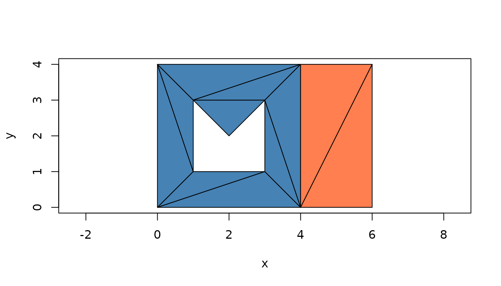
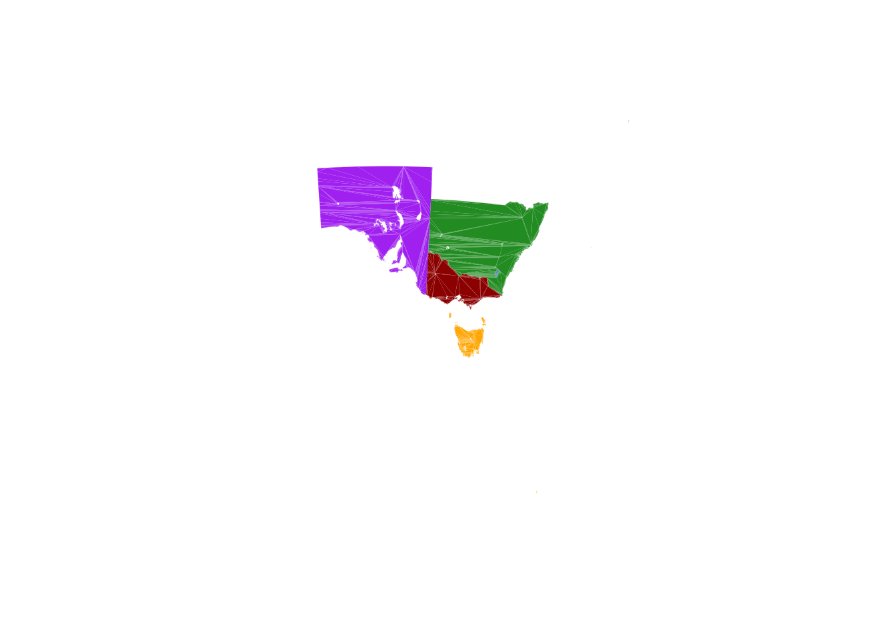
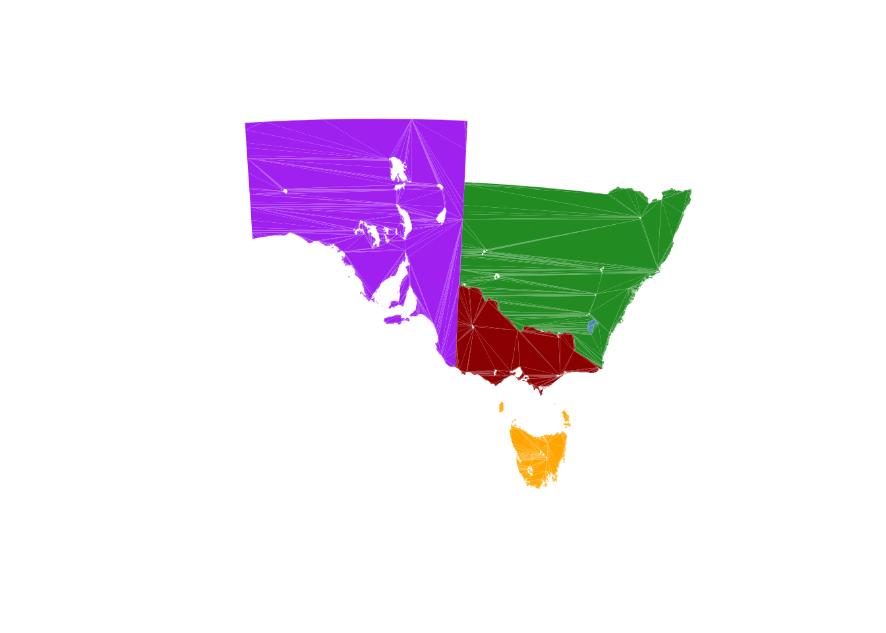
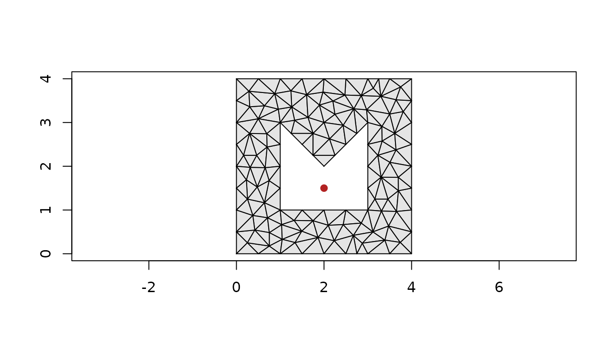
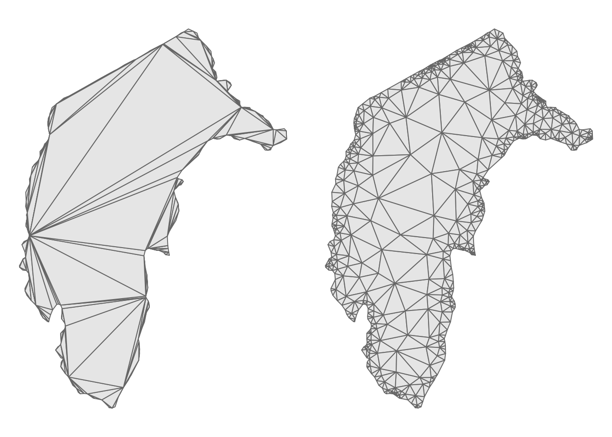
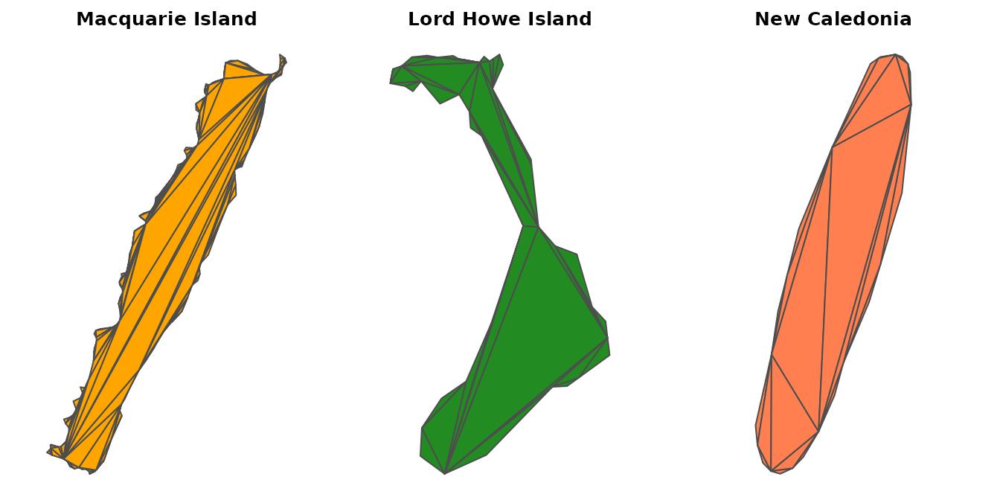

# Triangulation

A polygon in wkpool is a set of rings, and a ring is a cycle of
segments: one-dimensional topology. Triangles are the two-dimensional
version, and they can live on the same vertex pool. A `wkpool_tri` is a
vector of triangles whose corners are vertex ids into a pool, just as a
wkpool is a vector of segments.

`wkpool_tri` and
[`pool_triangulate()`](https://hypertidy.github.io/wkpool/reference/pool_triangulate.md)
are **experimental** (new in 0.4.0) and may change. The older route,
[`as_pslg()`](https://hypertidy.github.io/wkpool/reference/as_pslg.md)
and
[`pool_holes()`](https://hypertidy.github.io/wkpool/reference/pool_holes.md)
feeding RTriangle, is unchanged and is covered below alongside it.

``` r

library(wkpool)
```

## Ear cutting

[`pool_triangulate()`](https://hypertidy.github.io/wkpool/reference/pool_triangulate.md)
ear cuts each polygon with decido. Ear cutting adds no vertices, so the
triangles reference the pool’s vertices as they are.

``` r

x <- wk::as_wkb(c(
  "POLYGON ((0 0, 4 0, 4 4, 0 4, 0 0), (1 1, 1 3, 2 2, 3 3, 3 1, 1 1))",
  "POLYGON ((4 0, 6 0, 6 4, 4 4, 4 0))"
))
pool <- establish_topology(x)
tri <- pool_triangulate(pool)
tri
#> <wkpool_tri[11 triangles, 16 vertices]>
#>  [1] <triangle: 4,1,6>    <triangle: 7,8,9>    <triangle: 10,6,1>  
#>  [4] <triangle: 4,6,7>    <triangle: 10,1,2>   <triangle: 3,4,7>   
#>  [7] <triangle: 9,10,2>   <triangle: 3,7,9>    <triangle: 9,2,3>   
#> [10] <triangle: 14,15,12> <triangle: 12,13,14>
pool_triangles(tri)
#>    .vx0 .vx1 .vx2 .feature .part
#> 1     4    1    6        1     1
#> 2     7    8    9        1     1
#> 3    10    6    1        1     1
#> 4     4    6    7        1     1
#> 5    10    1    2        1     1
#> 6     3    4    7        1     1
#> 7     9   10    2        1     1
#> 8     3    7    9        1     1
#> 9     9    2    3        1     1
#> 10   14   15   12        2     2
#> 11   12   13   14        2     2
```

``` r

plot(tri, asp = 1)
```



Each triangle keeps the feature and part it came from, and triangles are
counter-clockwise.
[`wk_handle()`](https://paleolimbot.github.io/wk/reference/wk_handle.html)
gives one POLYGON per triangle, so any wk consumer can take them:

``` r

wk::as_wkt(tri)[1:3]
#> <wk_wkt[3]>
#> [1] POLYGON ((0 4, 0 0, 1 1, 0 4)) POLYGON ((1 3, 2 2, 3 3, 1 3))
#> [3] POLYGON ((3 1, 1 1, 0 0, 3 1))
```

Triangulating a raw pool and merging later gives the same result as
merging first. After merging, the two features share the corners on
their common edge.
[`tri_segments()`](https://hypertidy.github.io/wkpool/reference/pool_triangles.md)
gives the triangle edges as an ordinary wkpool, so the segment tools
apply; here the one edge the features share, once from each side:

``` r

tri <- merge_coincident(tri)
edges <- tri_segments(tri)
find_shared_edges(edges)
#>    edge_key .vx0 .vx1 .feature segment_idx features
#> 26      2-3    2    3        1          26     1, 2
#> 29      2-3    2    3        2          29     1, 2
```

## A real coverage

`inlandwaters` from silicate is six regions of Australia (and New
Caledonia) with many holes and long shared boundaries.

``` r

data("inlandwaters", package = "silicate")
# the geometry column as WKB, so sf is not needed
iw_geom <- wk::wk_handle(inlandwaters$geom, wk::wkb_writer())
iw <- merge_coincident(establish_topology(iw_geom))
iw_tri <- pool_triangulate(iw)
length(iw_tri)
#> [1] 33205
nrow(pool_vertices(iw_tri)) == nrow(pool_vertices(iw))
#> [1] TRUE
plot(iw_tri, border = NA, asp = 1, axes = FALSE, xlab = "", ylab = "")
```



[`plot()`](https://rdrr.io/r/graphics/plot.default.html) draws every
triangle in one [`polygon()`](https://rdrr.io/r/graphics/polygon.html)
call indexed into the pool, so tens of thousands of triangles draw in
well under a second.

The view is much bigger than the land. Three small, distant islands set
the extent: Macquarie Island far to the south, which is one part of the
Tasmania feature; Lord Howe Island to the east, one part of the New
South Wales feature; and the feature labelled New Caledonia to the north
east. Each triangle records its feature and part, so the islands can be
found from the triangles themselves and dropped with a subset. The plot
extent follows the triangles that are drawn:

``` r

tt <- pool_triangles(iw_tri)
ev <- pool_vertices(iw_tri)
tx <- ev$x[match(tt$.vx0, ev$.vx)]
ty <- ev$y[match(tt$.vx0, ev$.vx)]
prov <- inlandwaters$Province
nsw <- tt$.feature == which(prov == "New South Wales")
islands <- c(
  "Macquarie Island" = tt$.part[which.min(ty)],
  "Lord Howe Island" = tt$.part[nsw][which.max(tx[nsw])],
  "New Caledonia" = unique(tt$.part[tt$.feature == which(prov == "New Caledonia")])
)
islands
#> Macquarie Island Lord Howe Island    New Caledonia 
#>              126               16                4
plot(iw_tri[!tt$.part %in% islands], border = NA, asp = 1, axes = FALSE,
     xlab = "", ylab = "")
```



## Constrained Delaunay: the PSLG route

Ear cutting gives valid triangles but they are often long and thin, and
it cannot add vertices. For good-quality triangles (minimum angle,
maximum area) you need a constrained Delaunay triangulation, and its
input is a planar straight line graph (PSLG): vertices, and segments
that must appear as triangle edges. A merged pool is already a PSLG;
[`as_pslg()`](https://hypertidy.github.io/wkpool/reference/as_pslg.md)
just gives it as matrices, `P` for the vertices and `S` for the
segments, in the form RTriangle uses.

``` r

p <- as_pslg(establish_topology(wk::as_wkb(
  "POLYGON ((0 0, 4 0, 4 4, 0 4, 0 0), (1 1, 1 3, 2 2, 3 3, 3 1, 1 1))"
)))
str(p)
#> List of 2
#>  $ P: num [1:9, 1:2] 0 4 4 0 1 1 2 3 3 0 ...
#>  $ S: int [1:9, 1:2] 1 2 3 4 5 6 7 8 9 2 ...
```

A PSLG does not say which side of a segment is inside. RTriangle removes
the triangles outside the outer boundary, and needs a point in each hole
to remove those too.
[`pool_holes()`](https://hypertidy.github.io/wkpool/reference/pool_holes.md)
gives one point inside each hole ring (a hole that another polygon fills
exactly, like an enclave, is not a hole of the coverage and is left
out):

``` r

h <- pool_holes(merge_coincident(establish_topology(wk::as_wkb(
  "POLYGON ((0 0, 4 0, 4 4, 0 4, 0 0), (1 1, 1 3, 2 2, 3 3, 3 1, 1 1))"
))))
h
#>      x   y
#> [1,] 2 1.5
rt <- RTriangle::triangulate(RTriangle::pslg(P = p$P, S = p$S, H = h),
                             q = 30, a = 0.1)
plot(rt$P, asp = 1, pch = ".", xlab = "", ylab = "")
polygon(rt$P[t(cbind(rt$T, NA)), ], col = "grey90")
points(h, col = "firebrick", pch = 19)
```



RTriangle added vertices to meet the quality and area targets; those are
the Steiner points, appended after the input vertices.

## Back to a triangle pool

The result is a vertex table and an index table, which is all a
`wkpool_tri` is. The input vertices come first in the same order as the
pool, so their ids are unchanged and Steiner points get new ids after
them:

``` r

v <- data.frame(.vx = seq_len(nrow(rt$P)), x = rt$P[, 1], y = rt$P[, 2])
rt_tri <- new_wkpool_tri(v, rt$T[, 1], rt$T[, 2], rt$T[, 3])
length(rt_tri)
#> [1] 208
rt_tri[1:3]
#> <wkpool_tri[3 triangles, 131 vertices]>
#> [1] <triangle: 72,51,49>    <triangle: 106,103,105> <triangle: 47,19,17>
```

On real data the difference in triangle quality is plain. The first
feature of `inlandwaters` is the Australian Capital Territory: ear cut
on the left, long thin triangles fanning from a few vertices; through
RTriangle with a minimum angle of 25 degrees on the right, back on a
triangle pool:

``` r

act <- iw_tri[pool_feature(iw_tri) == 1]
act_p <- as_pslg(establish_topology(iw_geom[1]))
act_rt <- RTriangle::triangulate(RTriangle::pslg(P = act_p$P, S = act_p$S),
                                 q = 25)
act_v <- data.frame(.vx = seq_len(nrow(act_rt$P)),
                    x = act_rt$P[, 1], y = act_rt$P[, 2])
act_rt_tri <- new_wkpool_tri(act_v, act_rt$T[, 1], act_rt$T[, 2], act_rt$T[, 3])
c(earcut = length(act), RTriangle = length(act_rt_tri))
#>    earcut RTriangle 
#>       277       983
op <- par(mfrow = c(1, 2), mar = rep(0.5, 4))
plot(act, col = "grey90", border = "grey40", asp = 1, axes = FALSE,
     xlab = "", ylab = "")
plot(act_rt_tri, col = "grey90", border = "grey40", asp = 1, axes = FALSE,
     xlab = "", ylab = "")
```



``` r

par(op)
```

The PSLG route triangulates the whole pool at once and does not record
which feature a triangle belongs to;
[`pool_triangulate()`](https://hypertidy.github.io/wkpool/reference/pool_triangulate.md)
does, because it works one polygon at a time.

On `inlandwaters` RTriangle covers the same area as ear cutting, up to
one thing a PSLG cannot express with hole points alone: a region
enclosed by neighbouring polygons that none of them covers is not a hole
of any ring, so
[`pool_holes()`](https://hypertidy.github.io/wkpool/reference/pool_holes.md)
gives no point for it and RTriangle keeps it.

``` r

tri_area <- function(P, T) {
  sum(abs((P[T[, 2], 1] - P[T[, 1], 1]) * (P[T[, 3], 2] - P[T[, 1], 2]) -
          (P[T[, 3], 1] - P[T[, 1], 1]) * (P[T[, 2], 2] - P[T[, 1], 2]))) / 2
}
iw_p <- as_pslg(iw)
iw_rt <- RTriangle::triangulate(
  RTriangle::pslg(P = iw_p$P, S = iw_p$S, H = pool_holes(iw))
)
ev <- pool_vertices(iw_tri)
c(
  earcut = tri_area(cbind(ev$x, ev$y), as.matrix(pool_triangles(iw_tri)[1:3])),
  RTriangle = tri_area(iw_rt$P, iw_rt$T)
) / 1e6
#>    earcut RTriangle 
#>   1923706   1923944
```

## The islands

The three islands, each drawn from its own subset of the triangle pool:

``` r

op <- par(mfrow = c(1, 3), mar = c(0.5, 0.5, 2, 0.5))
for (nm in names(islands)) {
  plot(iw_tri[tt$.part == islands[nm]], border = "grey30", asp = 1,
       axes = FALSE, xlab = "", ylab = "", main = nm)
}
```



``` r

par(op)
```

A few things to notice:

- A subset is a set of triangles, not a copy of the coordinates: each
  island still references the full vertex pool, and its vertex ids are
  the ids in the whole coverage.

  ``` r

  mq <- iw_tri[tt$.part == islands["Macquarie Island"]]
  c(triangles = length(mq), pool_vertices = nrow(pool_vertices(mq)))
  #>     triangles pool_vertices 
  #>           174         30835
  ```

- Ear cutting adds no vertices, so the count is fixed by the input: a
  polygon with `n` vertices and `h` holes gives `n + 2h - 2` triangles.
  These islands have no holes, so each has two fewer triangles than
  vertices:

  ``` r

  sapply(islands, function(k) {
    i <- tt$.part == k
    c(vertices = length(unique(unlist(tt[i, 1:3]))), triangles = sum(i))
  })
  #>           Macquarie Island Lord Howe Island New Caledonia
  #> vertices               176               46            26
  #> triangles              174               44            24
  ```

- The islands are a few kilometres to a few tens of kilometres across,
  the mainland states around a thousand. A maximum triangle area (`a` in
  RTriangle) is in map units, square metres here, so one value refines a
  small island and a large state very differently; a minimum angle (`q`)
  does not depend on scale.

## Which engine

| Engine | Adds vertices | Keeps feature | Holes from |
|----|----|----|----|
| [`pool_triangulate()`](https://hypertidy.github.io/wkpool/reference/pool_triangulate.md) (decido) | no | yes | ring roles |
| RTriangle via [`as_pslg()`](https://hypertidy.github.io/wkpool/reference/as_pslg.md) | yes (quality, area) | no | [`pool_holes()`](https://hypertidy.github.io/wkpool/reference/pool_holes.md) points |

[meshcore](https://github.com/hypertidy/meshcore) offers further
constrained Delaunay engines behind `tri_mesh()`, with vertex origin
(input, crossing, Steiner) and depth recorded in its mesh tables.
