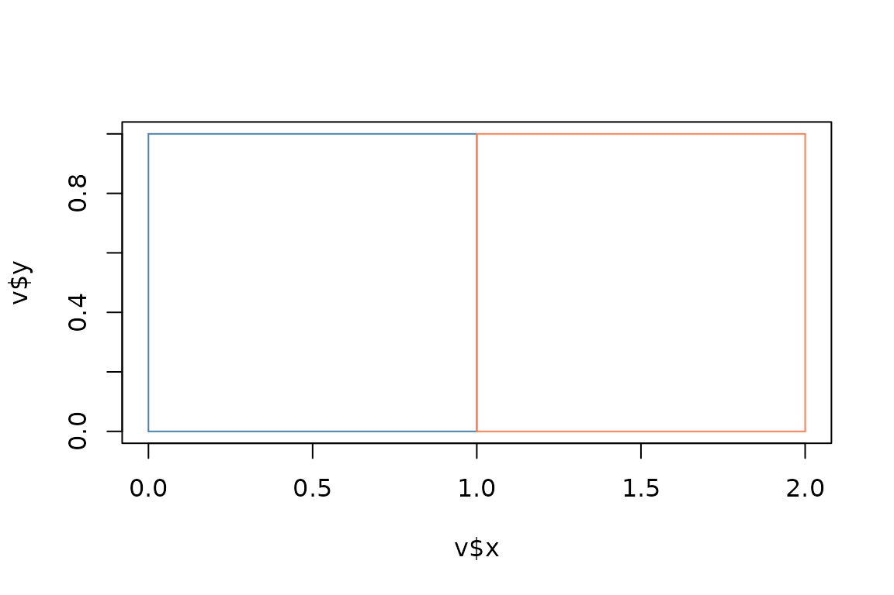

# wkpool: Topology-based Geometry Handling

## Why topology?

**wkpool** represents geometry as segments referencing a shared vertex
pool. Topology emerges naturally: shared edges, neighbours, and ring
structure become simple lookups.

Simple features store geometry as complete coordinate sequences per
feature. Two adjacent polygons duplicate their shared boundary —
wasteful in entropy and requiring spatial predicates (GEOS) to
rediscover adjacency.

## Basic workflow

Create two adjacent squares sharing an edge:

``` r

library(wk)
library(wkpool)

# Two adjacent unit squares
poly1 <- wkt("POLYGON ((0 0, 1 0, 1 1, 0 1, 0 0))")
poly2 <- wkt("POLYGON ((1 0, 2 0, 2 1, 1 1, 1 0))")
geoms <- c(poly1, poly2)
```

### Establish topology

``` r

pool <- establish_topology(geoms)
pool
#> <wkpool[8 segments, 10 vertices]>
#> [1] <segment: 1->2>  <segment: 2->3>  <segment: 3->4>  <segment: 4->5> 
#> [5] <segment: 6->7>  <segment: 7->8>  <segment: 8->9>  <segment: 9->10>
```

At this stage, vertices are indexed but not yet merged — the shared edge
exists as duplicate coordinate pairs.

### Inspect the raw state

``` r

topology_report(pool)
#> $n_vertices_raw
#> [1] 10
#> 
#> $n_vertices_unique
#> [1] 6
#> 
#> $n_duplicate_vertices
#> [1] 4
#> 
#> $n_near_miss_vertices
#> [1] 0
#> 
#> $n_segments
#> [1] 8
#> 
#> $n_shared_edges
#> [1] 1
#> 
#> $n_features
#> [1] 2
```

### Access the pool components

``` r

pool_vertices(pool)
#>    .vx x y
#> 1    1 0 0
#> 2    2 1 0
#> 3    3 1 1
#> 4    4 0 1
#> 5    5 0 0
#> 6    6 1 0
#> 7    7 2 0
#> 8    8 2 1
#> 9    9 1 1
#> 10  10 1 0
pool_segments(pool)
#>   .vx0 .vx1 .feature .path
#> 1    1    2        1     1
#> 2    2    3        1     1
#> 3    3    4        1     1
#> 4    4    5        1     1
#> 5    6    7        2     2
#> 6    7    8        2     2
#> 7    8    9        2     2
#> 8    9   10        2     2
pool_feature(pool)
#> [1] 1 1 1 1 2 2 2 2
```

### Merge coincident vertices

``` r

pool <- merge_coincident(pool)
topology_report(pool)
#> $n_vertices_raw
#> [1] 6
#> 
#> $n_vertices_unique
#> [1] 6
#> 
#> $n_duplicate_vertices
#> [1] 0
#> 
#> $n_near_miss_vertices
#> [1] 0
#> 
#> $n_segments
#> [1] 8
#> 
#> $n_shared_edges
#> [1] 1
#> 
#> $n_features
#> [1] 2
```

After merging, shared edge vertices reference the same pool indices.

## Adjacency discovery

### Shared edges

``` r

find_shared_edges(pool)
#>   edge_key .vx0 .vx1 .feature segment_idx features
#> 2      2-3    2    3        1           2     1, 2
#> 8      2-3    2    3        2           8     1, 2
```

Returns segment indices that appear in multiple features.

### Internal boundaries

For polygon data, shared edges with *opposite* winding indicate true
internal boundaries (not self-shared rings):

``` r

find_internal_boundaries(pool)
#> <wkpool[2 segments, 6 vertices]>
#> [1] <segment: 2->3> <segment: 3->2>
```

### Neighbour graph

``` r

find_neighbours(pool)
#>   feature_a feature_b
#> 3         1         2
```

Returns a data frame of feature pairs that share an edge.

## Ring and cycle analysis

Topology enables ring discovery without parsing WKT structure.

### Find closed cycles

``` r

cycles <- find_cycles(pool)
cycles
#> [[1]]
#> [1] 1 2 3 4
#> 
#> [[2]]
#> [1] 2 5 6 3
#> 
#> attr(,"path")
#> [1] 1 2
```

### Classify by winding

Signed area distinguishes outer rings from holes. Following the SF
convention, negative area indicates an outer ring, positive indicates a
hole:

``` r

# Area of the first cycle
cycle_signed_area(cycles[[1]], pool_vertices(pool))
#> [1] 1

# Classify all cycles
classify_cycles(pool)
#>   cycle area  type .path .feature
#> 1     1    1 outer     1        1
#> 2     2    1 outer     2        2
```

Use
[`reverse_cycle()`](https://hypertidy.github.io/wkpool/reference/reverse_cycle.md)
to flip winding if needed.

## Arc-node topology

Arcs are maximal sequences of segments passing through degree-2
vertices. Nodes are vertices where degree ≠ 2 (branch points or
endpoints).

``` r

vertex_degree(pool)
#> 1 2 3 4 5 6 
#> 2 4 4 2 2 2
find_nodes(pool)
#> [1] 2 3
find_arcs(pool)
#> [[1]]
#> [1] 2 1 4 3
#> 
#> [[2]]
#> [1] 2 3
#> 
#> [[3]]
#> [1] 2 5 6 3
#> 
#> [[4]]
#> [1] 2 3
arc_node_summary(pool)
#> $n_vertices
#> [1] 6
#> 
#> $n_nodes
#> [1] 2
#> 
#> $n_arcs
#> [1] 4
#> 
#> $degree_distribution
#> deg
#> 2 4 
#> 4 2 
#> 
#> $arc_length_distribution
#> arc_lengths
#> 1 3 
#> 2 2 
#> 
#> $mean_arc_length
#> [1] 2
```

The two squares share an edge and each square carries its own copy of
it, so the shared vertices have degree 4 and the shared edge comes back
as two arcs, one per square. In the quotient graph a duplicated boundary
counts once: the shared edge is a single arc, and its end vertices stay
nodes because three distinct edges meet there. On a coverage with long
shared boundaries the difference is large (on silicate’s `inlandwaters`,
5,418 arcs and 2,619 nodes by default, 201 arcs and 13 nodes in the
quotient graph). Use `quotient = TRUE` for polygon coverages.

``` r

find_nodes(pool, quotient = TRUE)
#> [1] 2 3
find_arcs(pool, quotient = TRUE)
#> [[1]]
#> [1] 2 1 4 3
#> 
#> [[2]]
#> [1] 2 3
#> 
#> [[3]]
#> [1] 2 5 6 3
```

## Round-trip to WKT

Convert topology back to standard geometry formats:

``` r

# Arcs as linestrings
arcs_to_wkt(pool)
#> <wk_wkt[4]>
#> [1] LINESTRING (1 0, 0 0, 0 1, 1 1) LINESTRING (1 0, 1 1)          
#> [3] LINESTRING (1 0, 2 0, 2 1, 1 1) LINESTRING (1 0, 1 1)

# Cycles as polygons
cycles_to_wkt(pool)
#> <wk_wkt[2]>
#> [1] POLYGON ((0 0, 1 0, 1 1, 0 1, 0 0)) POLYGON ((1 0, 2 0, 2 1, 1 1, 1 0))

# Raw segments
segments_to_wkt(pool, type = "linestring")[1:3]
#> <wk_wkt[3]>
#> [1] LINESTRING (0 0, 1 0) LINESTRING (1 0, 1 1) LINESTRING (1 1, 0 1)
```

## Triangulation integration

The pool maps directly to constrained triangulation inputs.

### RTriangle (PSLG)

``` r

pslg <- as_pslg(pool)
str(pslg)
#> List of 2
#>  $ P: num [1:6, 1:2] 0 1 1 0 2 2 0 0 1 1 ...
#>  $ S: int [1:8, 1:2] 1 2 3 4 2 5 6 3 2 3 ...
```

For polygons with holes, use
[`pool_holes()`](https://hypertidy.github.io/wkpool/reference/pool_holes.md)
to generate interior points that tell the triangulator which regions to
exclude:

``` r

# A polygon with a hole
holed <- wk::as_wkb(
  "POLYGON ((0 0, 4 0, 4 4, 0 4, 0 0), (1 1, 3 1, 3 3, 1 3, 1 1))"
)
hp <- establish_topology(holed)
hp <- merge_coincident(hp)
pslg_h <- as_pslg(hp)
holes <- pool_holes(hp)
tri <- RTriangle::triangulate(
  RTriangle::pslg(P = pslg_h$P, S = pslg_h$S, H = holes)
)
```

## Subsetting and combining

Pools support `[` subsetting — the full vertex pool is retained:

``` r

pool[1:4]
#> <wkpool[4 segments, 6 vertices]>
#> [1] <segment: 1->2> <segment: 2->3> <segment: 3->4> <segment: 4->1>
```

Combine pools from different sources:

``` r

pool_a <- establish_topology(wk::wkt("POLYGON ((0 0, 1 0, 1 1, 0 1, 0 0))"))
pool_b <- establish_topology(wk::wkt("POLYGON ((5 5, 6 5, 6 6, 5 6, 5 5))"))
pool_combine(pool_a, pool_b)
#> <wkpool[8 segments, 10 vertices]>
#> [1] <segment: 1->2>  <segment: 2->3>  <segment: 3->4>  <segment: 4->5> 
#> [5] <segment: 6->7>  <segment: 7->8>  <segment: 8->9>  <segment: 9->10>
```

## Visualization

``` r

plot(pool)
```



## Related Work

### Core topology/vertex-pool (hypertidy ecosystem)

| Package | Where | Relationship to wkpool |
|----|----|----|
| [silicate](https://CRAN.R-project.org/package=silicate) | CRAN | Mature predecessor — `SC` (edge-vertex), `ARC` (shared boundaries), `PATH` models. wkpool is the `wk`-native successor |
| [unjoin](https://CRAN.R-project.org/package=unjoin) | CRAN | Vertex deduplication via data frame normalization — used internally by silicate |
| [wk](https://CRAN.R-project.org/package=wk) | CRAN | Path/geometry indexing via [`wk_coords()`](https://paleolimbot.github.io/wk/reference/wk_vertices.html) |

### Mesh/triangulation

| Package | Where | Notes |
|----|----|----|
| [RTriangle](https://CRAN.R-project.org/package=RTriangle) | CRAN | Shewchuk’s Triangle — constrained Delaunay, [`as_pslg()`](https://hypertidy.github.io/wkpool/reference/as_pslg.md) target |
| [decido](https://CRAN.R-project.org/package=decido) | CRAN | Earcut, fast, returns vertex indices (implicit pool); no wkpool converter yet |
| [sfdct](https://CRAN.R-project.org/package=sfdct) | CRAN | RTriangle wrapper for sf objects |

### Adjacency (computed, not stored)

| Package | Where | Approach |
|----|----|----|
| [sfdep](https://CRAN.R-project.org/package=sfdep) | CRAN | `st_contiguity()` computes on-demand |
| [sf](https://CRAN.R-project.org/package=sf) | CRAN | `st_touches()`, `st_relate()` via GEOS — recomputes each time |

**Key distinction**: wkpool differs from sf/spdep by *storing* topology
(shared edges are explicit) rather than *computing* it on demand via
GEOS. It’s a lightweight, `wk`-native evolution of silicate’s approach.
